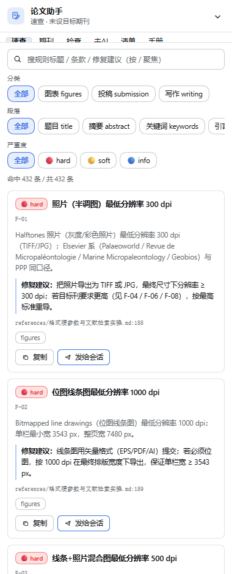
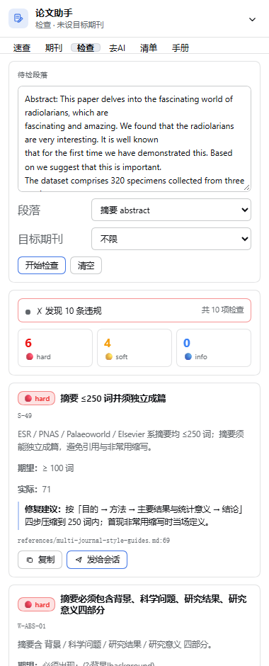
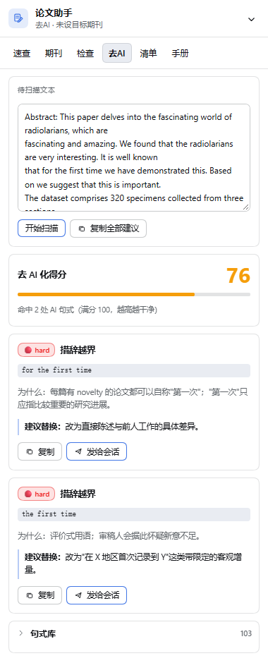
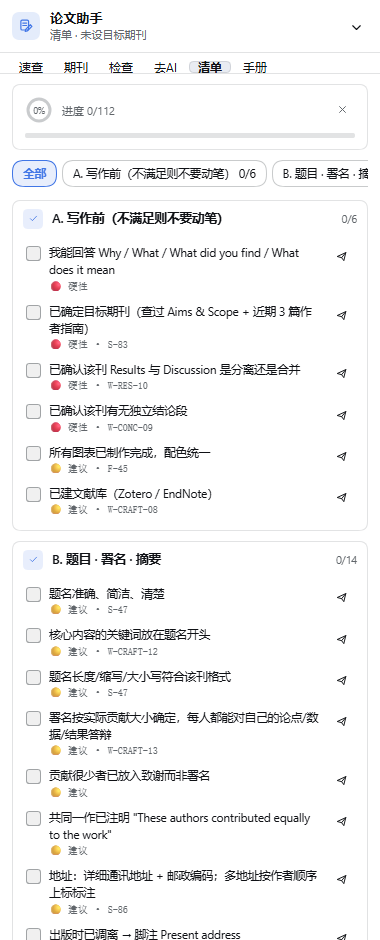

# dsh-academic-paper-polish

> 把 [academic-paper-polish](https://github.com/syxscott/academic-paper-polish) 做成
> **DeepSeek Harness 的能力层**：模型可以**调用**的工具、人类可以**输入**的命令、
> 面板可以**驱动**的会话，以及一份**可判定**的规则库 —— 不再只是一本手册。

| 速查 | 检查 | 去AI | 清单 |
|---|---|---|---|
|  |  |  |  |

- 内容来源：`syxscott/academic-paper-polish` v2.16.1（MIT），见 [`NOTICE`](NOTICE)
- 形态：**host + client 双半边** bundle，**零第三方依赖**、无构建步骤、**无任何外部网络请求**
- 生效范围：`desktop` profile 下所有会话
- 当前版本：**3.0.0**

---

## 1. v3.0 改了什么：从「手册」到「能力」

v2.4.0 只有一个 skill provider —— 一本 61,093 词的散文手册，模型**可以读、但不一定读**，
而且规则全靠模型自己回忆。v3.0 把同一份知识拆成两种形态：

| | v2.4.0 | v3.0 |
|---|---|---|
| 模型能拿到的 | 一本手册 | 手册 **+ 5 个可调用的工具** |
| 人类能用的 | 无 | **5 个斜杠命令** |
| 插件主动告知模型的 | 无 | **一段 126 字符的系统提示段** |
| 规则的形态 | 散文 | **432 条机器可判定规则**（329 通用 + 103 期刊专属） |
| 期刊信息 | 4 份 markdown | **28 本期刊的结构化档案**（字数/图数/APC/审稿周期/段结构） |
| 去 AI 化 | 一份句式库散文 | **103 条可扫描的句式模式 + 0–100 得分** |
| 投稿前自查 | 清单 markdown | **16 个阶段 / 112 项，带进度环与落盘** |
| 面板 | 8 个只读视图 | **6 个 API 驱动视图**，能查、能检、能发到会话 |
| 面板 → 会话 | 只能复制到剪贴板 | **一键注入当前会话**（宿主 inbox，官方通道） |

规则库和手册**同源**：规则从手册抽取，每条都带 `source: { file, line }`，
面板上点一条就能看到它在手册里的出处。

---

## 2. 四层交互面

```
              ┌──────────────────────────────────────────────┐
  人类 ──────▶│ /paper-check · /paper-rules · /paper-journals │  斜杠命令
              │ /paper-outline · /paper-deai                   │  ctx.commands
              └──────────────────────────────────────────────┘
  模型 ──────▶│ paper_check · paper_rules · paper_journals      │  工具
              │ paper_outline · paper_deai                     │  ctx.tools
              └──────────────────────────────────────────────┘
  每次请求 ──▶│ "…有 paper_* 工具，写改稿请调用，勿凭记忆套规则" │  提示段
              └──────────────────────────────────────────────┘  ctx.systemPrompt.section
  面板 ──────▶│ GET/POST /dsh-academic-paper-polish/api/*      │  同源 JSON 通道
              └──────────────────────────────────────────────┘  零 token
```

四个面都挂在官方服务上，没有自造协议：

| 面 | 官方接口 | 代价 |
|---|---|---|
| 技能 | `ctx.skills.registerProvider(() => provider)` | 模型可能不读 |
| **工具** | `ctx.tools.register(definition)` | 每次请求 +5 个 tool schema |
| **命令** | `ctx.commands.register(definition)` | 0 |
| **提示段** | `ctx.systemPrompt.section({ name, order: 2950, text })` | 每次请求 +126 字符 |
| **面板通道** | `ctx.webServer.register({ kind: 'prefix', path })` | 0 |

提示段只有 126 个字符（29 个汉字），因为它**每次请求都会注入**。
它只做一件事：告诉模型「有这些工具，别凭记忆」。

---

## 3. 五个工具

模型可以直接调用。描述里写清了**何时调用**——这是模型发现它们的唯一途径。

| 工具 | 参数 | 做什么 |
|---|---|---|
| `paper_check` | `text?` `path?` `section?` `journal?` | 把正文按段落切开，逐条跑规则库，返回违规清单（规则 id、条款、期望 vs 实际、修复建议、出处）+ 未能自动判定的指导条目 |
| `paper_rules` | `query?` `section?` `severity?` `journal?` `limit?` | 按关键词 / 段落 / 严重度 / 目标期刊切规则库 |
| `paper_journals` | `query?` `field?` `openAccess?` `maxApc?` | 主题 → 期刊排序（精确名 > 领域 > 范围匹配） |
| `paper_outline` | `journal?` `section?` | 目标期刊的官方段结构 + 篇幅/图数上限；未识别期刊时回退到通用骨架 |
| `paper_deai` | `text?` `path?` | 扫去 AI 化句式，返回命中、类别、原因、替换建议与 0–100 得分 |

**判定是确定性的**：规则库 432 条里，**291 条**（67%）可以自动判定
（`required` 149 · `forbidden` 58 · `numeric` 46 · `count` 14 · `wordCount` 9 ·
`sectionOrder` 8 · `citationDensity` 7），
另有 **141 条 `manual`** 规则作为「无法自动判定但必须知道」的指导一并返回，不会被吞掉。

### 期刊归属（v3.0 修掉的最大正确性问题）

「PE 必须提供 plain language summary」不是 Earth-Science Reviews 的要求。
规则可以带 `journals: ["palaeontologia-electronica"]`，表示**只属于该刊**：

| 检查目标期刊 | 通用规则 | 期刊专属规则 |
|---|---|---|
| 未指定 | 全部 329 条 | **跳过 103 条**，并在输出里说明「未指定目标期刊，跳过了 103 条期刊专属规则」 |
| `ESR` / `earth-science-reviews` | 全部 | 只应用 ESR 的 4 条 |
| `PE` / `Palaeontologia Electronica` | 全部 | 应用 PE 的 9 条 |
| 无法识别的刊名 | 全部 | 跳过全部，并标记 `journalUnknown` |

期刊名、key、缩写（`PE` `APP` `PPP` `ES&T` `ESR` `JM` `GCA` `PalZ`）都能解析。

---

## 4. 五个斜杠命令

| 命令 | 用法 | 作用 |
|---|---|---|
| `/paper-check` | `路径` 或直接粘贴正文，可加 `journal=Palaeontology` | 跑体检，输出违规表格 |
| `/paper-rules` | `关键词`，可加 `section=` `journal=` `severity=` | 查规则表 |
| `/paper-journals` | `主题`，如 `三叠纪 牙形石 系统分类` | 选刊排序表 |
| `/paper-outline` | `期刊名`，可加 `section=abstract` | 段结构骨架 |
| `/paper-deai` | `路径` 或粘贴正文 | 去 AI 化扫描 |

`/paper-check` 与 `/paper-deai` 声明了 `input.attachments`，可以直接带文件。

---

## 5. 面板：6 个视图（右栏唯一入口）

| 视图 | 内容 | 调用的宿主接口 |
|---|---|---|
| **速查** | 规则卡：严重度徽章（🔴 hard / 🟡 soft / 🔵 info）、条款、修复建议、出处 `file:line`；分类 / 段落 / 严重度三组 chip；250 ms 防抖搜索 | `GET api/rules?query=&section=&severity=` |
| **期刊** | 可排序表格（期刊 / 出版社 / IF / 开放获取 / 审稿周期 / APC / 段结构）；搜索、仅 OA、APC 上限、领域 chip；点行进详情 + 「设为目标期刊」 | `GET api/journals?query=&field=&openAccess=&maxApc=` |
| **检查** | 文本域 + 段落自动识别 + 目标期刊 → 严重度汇总条 + 违规卡（期望 vs 实际、命中片段、出处） | `POST api/check` |
| **去AI** | 得分 0–100 + 进度条 + 命中卡（类别 / 命中文本 / 次数 / 原因 / 建议替换）+ 可折叠句式库 | `POST api/deai`、`GET api/sentences` |
| **清单** | 16 个阶段的 chip 条 + 进度环 + 逐条勾选（🔴硬性 / 🟡建议 + ruleId），落盘 `dsh-academic-paper-polish.checklist` | `GET api/checklists` |
| **手册** | 原 markdown 浏览器：文件索引 + 宿主全文检索（`skill-index?q=`） | `GET skill-index` |

- **右栏是唯一入口**：输入框下方不再注册 `conversation.composer.dock`（v2.4.0 起），
  渲染测试里有一条断言专门守着这条规则。
- **「发给会话」** 走宿主 `POST api/send`，把选中的规则 / 违规 / 清单项注入**当前会话**。
  消息带自定义来源标记 `academic-paper-polish`（**不是** `user`）——
  Harness 会把它渲染成一条带出处的「注入」行，而不是冒充人类发言。
- 401 / 404 / 网络不可达三种错误态**互不混淆**，且面板 chrome 始终在。

---

## 6. 宿主路由

前缀 `/dsh-academic-paper-polish`（**不带结尾斜杠**）。同一道信任栅栏
（`connection.requestRejection`：Host/Origin 检查 + 浏览器会话 cookie）。

```
GET  /skill-index[?q=]        手册文件索引 / 正文全文检索（逐行扫磁盘，命中行片段）
GET  /api/meta                 计数、领域、段落词表、严重度词表
GET  /api/rules?query&section&severity&limit
GET  /api/journals?query&field&openAccess&maxApc&limit
GET  /api/sentences?query
GET  /api/checklists?stage
POST /api/check   { text, section?, journal? }   → { violations, advice, summary }
POST /api/deai    { text }                       → { hits, score, total }
POST /api/outline { journal?, section? }         → { journal, sections, limits, notes }
POST /api/send    { text, sessionId? }           → 200 / 400 / 409 / 503
```

- **零 token**：面板查规则、查期刊、跑体检都不经过模型。
- 路由不可达时（无 `webServer` 的 headless profile）面板降级到打包时的内置索引并显示 🟡。
- `POST api/check` / `api/deai` **只接受正文**，不接受文件路径 —— 浏览器读宿主文件是越权面；
  路径只有工具与命令能用。

> 🔴 **前缀路径不能带结尾斜杠**。webserver 的匹配规则是
> `pathname === prefix || pathname.startsWith(prefix + '/')`，
> 注册 `/dsh-academic-paper-polish/` 会去比较 `startsWith('.../dsh-academic-paper-polish//')`，
> **永远匹配不上**，表现为路由静默 404。

---

## 7. 数据层

`data/` 是**机器可读**的知识库，schema 见 [`data/SCHEMA.md`](data/SCHEMA.md)。

| 文件 | 内容 |
|---|---|
| `data/rules/writing.json` | **197** 条写作规则（摘要/引言/综述/方法/结果/讨论/结论/去AI化/工艺/审稿回复） |
| `data/rules/figures.json` | **145** 条图件与表格规则（118 条 = 81.4% 可自动判定） |
| `data/rules/submission.json` | **90** 条投稿与审稿回复规则 |
| `data/journals.json` | **28** 本期刊：结构 / 篇幅上限 / 图数 / APC / 审稿周期 / 收录边界 / 官方原句出处 |
| `data/sentences.json` | **103** 条去 AI 化句式模式 |
| `data/checklists.json` | **16** 个阶段 / **112** 个自查项（与 `checklist.md` 的 112 个 □ 一一对应） |

合计 **432** 条规则，其中 **103** 条带期刊归属。

每个文件独立加载：某个文件缺失或 JSON 非法时只跳过该文件并告警，插件不会整体失败。

### 手册完整性是被测出来的，不是嘴上说的

`evals/evals.json` 是上游的评测集（26 个用例，每个用例声明「该加载哪个模块」
和「必须提到哪些事实」）。`scripts/eval-conformance.mjs` 用它反查手册：

```
✓ 171 assertions passed
  corpus files        : 39
  eval cases          : 26
  must_mention found  : 101 (0 only in the corpus, not in the loaded file)
  numeric coverage    : 6 covered by data/, 0 prose-only
  relative links      : 20
  orphan files        : 0
```

它同时检查：模块文件必须真的包含该模块的关键事实（不是「语料里别处有就行」）、
相对链接必须可达、每个文件都必须从 `SKILL.md` 可达、数字事实必须能从 `data/` 取到。

> v3.0 借这个工具修掉了上游在打包时留下的 7 处内容缺口与 16 处失效链接
> （`docs/PROMPTS-EN.md` 的链接指向的是上游仓库布局，打包后全是死链）。

---

## 8. 安装

由 `plugin_manager` 执行，不要手工改 profile：

```yaml
# 插件调用
plugin_manager:
  action: install_bundle
  target: C:\Users\Administrator\dsh-academic-paper-polish   # ← 见下方「跨盘符约束」
```

安装后可用 `plugin_manager(action: set_plugin, target: 'include:skill-academic-paper-polish', enabled: false)` 停用。

### 🔴 跨盘符约束（本机踩过的坑）

本机 profile 在 `C:` 盘，而源码在 `D:` 盘。**直接用 D: 路径安装会失败**：

```
dsh: cannot resolve profile bundle "dsh-academic-paper-polish" from the dsh installation or
C:\Users\Administrator\.dsh\profiles\desktop
```

原因：pnpm 为 `file:` 依赖生成的符号链接目标按**工作区所在盘**计算相对路径，跨盘时落成
`C:\Users\文档\...` 这种不存在的路径，profile 解析 bundle 时 `existsSync` 失败。

绕法：先在**与 profile 同盘**的位置建一个 junction 指向源码，再从该路径安装。

```powershell
New-Item -ItemType Junction -Path "C:\Users\Administrator\dsh-academic-paper-polish" `
  -Target "D:\文档\编程项目\agent闲聊\dsh-academic-paper-polish"
# 然后 install_bundle 的 target 用 C:\Users\Administrator\dsh-academic-paper-polish
```

源码仍只有一份（junction 指回工作区），改完刷新即生效。

### 备用通道（文件式技能）

若不想用插件通道，把 `skill/academic-paper-polish/` 整个目录拷到 `~/.agents/skills/` 即可，
DSH 的 `dsh-skill-filesystem` 会自动发现（rank 500）。注意：文件式安装时 `SKILL.md` 里的
`{{SKILL_DIR}}` 不会自动替换，需自己填成绝对路径；**工具、命令与面板不可用**。

> ⚠️ 两条通道**同名会互相遮蔽**：预设层的 `skill-filesystem`（更近的 scope）会盖住宿主层的插件技能。
> 只留一条即可，推荐只留插件通道。

---

## 9. 自检

```bash
node scripts/audit.mjs                 # 静态审计 36 条：语法 / 外链 / fetch 面 / CSS 变量 / 能力层一致性
node scripts/eval-conformance.mjs      # 手册完整性 171 条（上游评测集反查）
node scripts/host-route-test.mjs       # 宿主路由 + 工具 + 命令 183 条
node scripts/run-interaction-test.mjs  # 浏览器内交互 76 条
node scripts/render-test.mjs           # 6 视图 × 1 槽位渲染无崩溃
node scripts/smoke-test.mjs            # 技能 provider 离线自检
node scripts/check-inline-scripts.mjs  # 预览台内联脚本语法
node scripts/code-metrics.mjs          # 代码量统计
node scripts/tag-journal-rules.mjs     # 期刊归属回填（幂等，--apply 才写）
node scripts/tighten-numeric-patterns.mjs  # 数值正则收紧（--apply 才写）
node scripts/build-preview-data.mjs     # 预览台的离线数据（真实 data/** + 真实引擎输出）
node scripts/asar-ls.mjs <path-regex> --grep <pattern>  # 读 app.asar 里的真实实现
```

**466 条断言**（36 + 171 + 183 + 76）全部通过。

### 视觉自验证管线

```bash
node scripts/extract-theme-tokens.mjs  # 从 app.asar 抽真实主题 CSS → preview/tokens.css
node scripts/shoot-views.mjs           # Chrome headless 批量截图 → preview/v3-*.png
node scripts/shoot-views.mjs dark      # 暗色
```

> ⚠️ 主题 CSS 必须**整段**从 app.asar 抽。只抽第一段 `body{…}` 会丢掉
> `body[data-ds-dark-theme]` 那份 alias 覆盖，结果是**暗色截图和亮色逐字节相同**——
> 看起来"验过了"，其实暗色根本没渲染过。

---

## 10. 代码量

| 层 | 文件 | 代码行 | 体积 |
|---|---|---|---|
| 宿主 `index.js` | 1 | 664 | 29.2 KB |
| 宿主 `lib/` | 6 | 1,861 | 79.1 KB |
| 客户端 `client.js` | 1 | 3,467（JS 2,186 + CSS 244 + 内置索引 1,037） | 137.6 KB |
| **规则库** `data/` | 7 | 15,605 行 JSON | 523.6 KB |
| 脚本 `scripts/` | 18 | 2,538 | 128.5 KB |
| 预览台 `preview/` | 3 + 25 张图 | 737 | 1.4 MB |
| **手册内容** `skill/` | 40 | 7,333 行 / **61,093 词** | 613.1 KB |
| **合计** | 113 | **33,944 行** | 2.9 MB |

运行时代码（宿主 + 客户端）≈ **5,992 行**。

---

## 11. 已知边界（诚实清单）

1. **数值检查是正则近似，不是量具**。`numeric` 检查取文本中第一个匹配的数，
   所以它给的是**线索**，不是判决。已做的收紧：数字边界（`220 mm` 不会再被读成 `20`）+
   量纲关键词锚定（字号规则不会再拿到线宽的数字）。但「dpi: 300」到底是哪个 dpi 档，
   文本本身没写清楚时无法判断。
2. **`required` 类规则按「缺一个 = 一条违规」的字面语义实现**，所以短文会得到较多条数。
   模型看到的输出有行数上限，JSON 里的 `summary.total` 是真实总数。
3. **未指定目标期刊时会跳过 103 条期刊专属规则**。这不是 bug —— 「Paleobiology 要求 8 pt 字号」
   在不知道目标刊时没有意义 —— 但模型必须知道这件事，所以输出里会明说跳过了多少条。
4. **`api/check` / `api/deai` 只收正文不收路径**（浏览器读宿主文件是越权面）。
   路径只有工具与命令能用。
5. **面板的分类（domain）筛选在客户端做**（宿主路由只接受 query/section/severity），
   所以选分类后「命中数」与「总数」会有偏差，UI 按过滤后的数量展示。
6. **真 GUI 驱动不了**：`127.0.0.1:1679` 没有 `dsh-auth-*` cookie 会返回 401，
   回归网是 file:// + CDP。`props.inputActions` 兜底未在真机验证过。
7. **去 AI 化得分不是「过 AI 检测」的保证**，也做不到。它只是把你自己的句式库命中量化。

---

## 12. 从上游同步

```powershell
$src = "D:\文档\编程项目\agent闲聊\academic-paper-polish-src"
$dst = "D:\文档\编程项目\agent闲聊\dsh-academic-paper-polish\skill\academic-paper-polish"
git -C $src pull
# 只覆盖 prompts/ prompts-en/ references/ docs/ agents/，SKILL.md 保留 DSH 适配段
Copy-Item "$src\skills\academic-paper-polish\prompts\*"   "$dst\prompts\"   -Recurse -Force
Copy-Item "$src\skills\academic-paper-polish\prompts-en\*" "$dst\prompts-en\" -Recurse -Force
Copy-Item "$src\skills\academic-paper-polish\references\*" "$dst\references\" -Recurse -Force
Copy-Item "$src\docs\*"                                   "$dst\docs\"       -Force
Copy-Item "$src\AGENTS.md"                                "$dst\references\AGENTS.md" -Force
```

同步后重跑 `node scripts/eval-conformance.mjs` 与 `node scripts/tag-journal-rules.mjs --apply`：
前者会告诉你哪些模块文件缺了必需事实，后者会重新回填期刊归属。

---

## 许可

MIT，见 [`LICENSE`](LICENSE)。上游内容 MIT，见 [`LICENSE.upstream`](LICENSE.upstream)
与 [`NOTICE`](NOTICE)。

- 本仓库（插件代码、规则库、面板）：© Syxscott，MIT
- skill 内容（`skill/**`）：改编自 [syxscott/academic-paper-polish](https://github.com/syxscott/academic-paper-polish)，MIT
