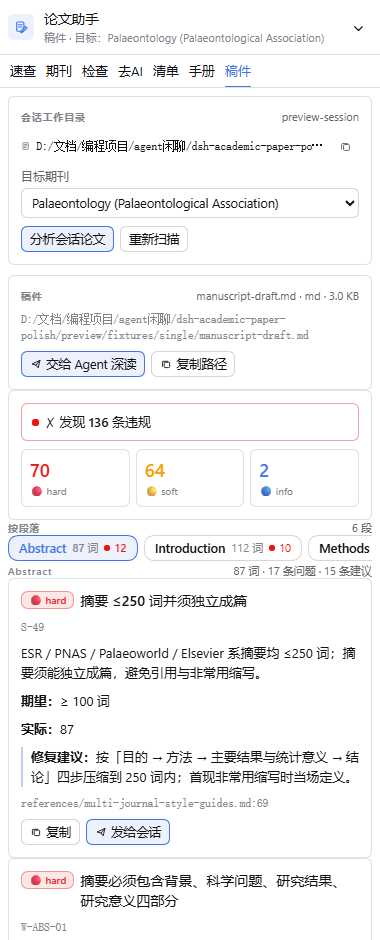
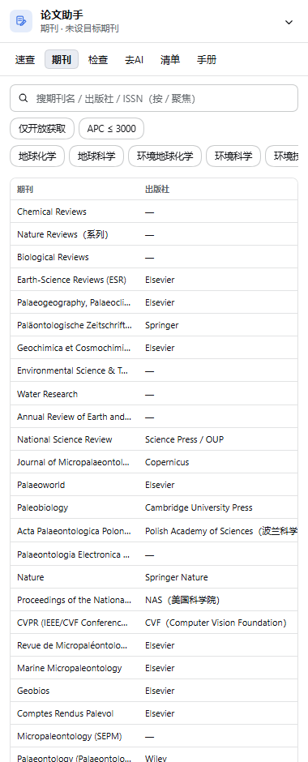

# dsh-academic-paper-polish

> 把 [academic-paper-polish](https://github.com/syxscott/academic-paper-polish) 做成
> **DeepSeek Harness 的能力层**：模型可以**调用**的工具、人类可以**输入**的命令、
> 面板可以**读会话里的稿件并逐段给意见**，以及一份**可判定**的规则库。

| 速查 | 稿件分析 |
|---|---|
|  |  |

| 期刊匹配 | 去 AI 化 |
|---|---|
|  |  |

- 内容来源：`syxscott/academic-paper-polish` v2.16.1（MIT），见 [`NOTICE`](NOTICE)
- 形态：**host + client 双半边** bundle，**零第三方依赖**、无构建步骤、**无任何外部网络请求**
- 生效范围：`desktop` profile 下所有会话
- 当前版本：**3.1.0**

---

## 1. 它现在能做什么

| 场景 | 用什么 |
|---|---|
| 写完一节，不确定合不合规范 | 模型直接调 `paper_check` 工具，或敲 `/paper-check` |
| 稿子就在会话目录里 | 面板「稿件」视图 → **一键扫描当前会话目录**，自动挑出论文文件，逐段给意见 |
| 想让**模型**逐段审一篇稿子 | `paper_analyze` 工具 / `/paper-analyze` → 按摘要/引言/方法/结果/讨论/结论逐段体检 |
| 有好几份稿件不知道哪份是 | 自动挑不出唯一赢家时**弹选择框**让你选 |
| 想要 AI 味的诊断 | `paper_deai` / `/paper-deai` → 命中句式 + 原因 + 替换建议 + 0–100 分 |
| 要投哪本刊 | `paper_journals` / `/paper-journals` → 28 本刊按主题排序，带 APC / 审稿周期 / 段结构 |
| 这本刊要什么结构 | `paper_outline` / `/paper-outline` → 该刊官方段结构 + 篇幅上限 |
| 想让 Agent 逐段精读 | 面板「交给 Agent 深读」→ 带绝对路径 + 期刊 + 规则 id 的指令进当前会话 |
| 要一条条核对投稿清单 | 面板「清单」16 阶段 / 112 项，带进度环与落盘 |
| 想知道面板在真机里是否活着 | `node scripts/read-panel-activity.mjs` → 读面板写的活动信标 |

---

## 2. 四层交互面

```
              ┌──────────────────────────────────────────────┐
  人类 ──────▶│ /paper-check · /paper-rules · /paper-journals │  斜杠命令
              │ /paper-outline · /paper-deai                   │  ctx.commands
              └──────────────────────────────────────────────┘
  模型 ──────▶│ paper_check · paper_rules · paper_journals      │  工具
              │ paper_outline · paper_deai · paper_analyze      │  ctx.tools
              └──────────────────────────────────────────────┘
  每次请求 ──▶│ "…有 paper_* 工具，写改稿请调用，勿凭记忆套规则" │  提示段
              └──────────────────────────────────────────────┘  ctx.systemPrompt.section
  面板 ──────▶│ GET/POST /dsh-academic-paper-polish/api/*      │  同源 JSON 通道
              └──────────────────────────────────────────────┘  零 token
```

| 面 | 官方接口 | 代价 |
|---|---|---|
| 技能 | `ctx.skills.registerProvider(() => provider)` | 模型可能不读 |
| **工具** | `ctx.tools.register(definition)` | 每次请求 +6 个 tool schema |
| **命令** | `ctx.commands.register(definition)` | 0 |
| **提示段** | `ctx.systemPrompt.section({ name, order: 2950, text })` | 每次请求 +145 字符 |
| **面板通道** | `ctx.webServer.register({ kind: 'prefix', path })` | 0 |

提示段只有 145 个字符（39 个汉字），因为它**每次请求都会注入**。
它只做一件事：告诉模型「有这些工具，别凭记忆」。

---

## 3. 面板：7 个视图（右栏唯一入口）

| 视图 | 内容 |
|---|---|
| **速查** | 规则卡：严重度徽章（🔴 hard / 🟡 soft / 🔵 info）、条款、修复建议、出处 `file:line`；分类 / 段落 / 严重度 chip + 防抖搜索 |
| **期刊** | 可排序表格（期刊 / 出版社 / IF / OA / 审稿周期 / APC / 段结构）；搜索、仅 OA、APC 上限、领域 chip；「设为目标期刊」 |
| **检查** | 粘贴正文 → 逐条违规（规则 id、期望 vs 实际、修复建议、出处）+ 严重度汇总条 |
| **去AI** | 得分 0–100 + 命中卡（类别 / 命中文本 / 次数 / 原因 / 建议替换）+ 句式库 |
| **清单** | 16 阶段 / 112 项，带进度环、折叠分组与落盘 |
| **手册** | 手册全文浏览器（宿主全文检索，`skill-index?q=`） |
| **稿件** | **扫描当前会话目录 → 自动挑出论文 → 逐段体检**（见 §4） |

- **右栏是唯一入口**：输入框下方不注册 `conversation.composer.dock`（v2.4.0 起）。
- **UI 按官方规范做**（对齐官方 `Plugin Manager` 页面与 `references/practices.md`）：
  - **响应式用 CSS container query**（`container-type: inline-size` + `@container`，
    断点 ≤380 / ≤420 / ≥600）——右栏宽度 ≠ 视口宽度，media query 在可拖拽右栏里必然失效；
  - **零字面色**：全部 `--dsw-alias-*` 派生；间距 2/4/6/8/10/12/14/16/20/24，
    字号 10/11/11.5/12/12.5/13/13.5/14(+18/20)，圆角 `--dsw-radius-*`；
  - **官方状态范式**：骨架屏、`status`/`empty`/`failure` 三件套、统一焦点环、
    hover 只在 `@media (hover:hover)` 下生效；
  - **发丝线** `0.5px solid var(--dsw-alias-border-l3)`；数字 `tabular-nums`；
    长文本 `overflow-wrap:anywhere`；flex 子项一律 `min-width:0`；grid 列一律 `minmax(0,1fr)`。

---

## 4. 稿件分析：读会话里的论文，逐段给意见

```
面板「稿件」→  GET  /api/session/files?sessionId=<当前会话>
              →  POST /api/analyze  { path, sessionId, journal? }
              →  POST /api/send     { text, sessionId }   ← 交给 Agent 精读
```

**会话 id 从哪来**：右栏 tab 是 **session scope** 的槽位，宿主的标准 props 里就有
`sessionId` 与 `useSessions`。面板**只用 slot props 里的 session id**——
v3.0 之前 `/api/send` 在没给 id 时会取「最近活跃的 agent」，可能发到**隔壁会话**，
v3.1 起这条猜测路径彻底去掉了。

**怎么挑出论文文件**：宿主扫描会话工作目录（深度 ≤3、跳过 `node_modules` 等 19 个目录、
跳过 >5 MB 的文件），给每个候选打分：

| 信号 | 分值 |
|---|---|
| 扩展名 | `.docx` 100 · `.tex` 90 · `.md` 70 · `.rtf` 60 · `.txt` 40 · `.pdf` 30 · `.odt` 25 · `.doc` 20 |
| 文件名含 paper / manuscript / article / draft / 论文 / 稿件 / 初稿… | +60 |
| 正文里出现 Abstract / 摘要 / Introduction / 引言 / Methods / Results / Discussion / Conclusion / References 等**行首标题** | +40/个，上限 +120 |
| 90 天内的修改 | 0–20 |

**自动选 vs 弹选择框**：最高分 ≥140 **且** ≥ 次高分的 1.6 倍 → 自动选中；
否则 `best = null`，面板**弹选择框**让用户挑（列出每个候选的文件名、大小、修改时间、
分数与中文理由；`.pdf`/`.doc`/`.odt` 列出但标灰——宿主读不了，需先用 office 技能转 docx）。

**怎么解析**：`.md/.txt/.tex/.rtf` 直接读；`.docx` 由宿主**自写 ZIP 解包**
（倒扫 EOCD → 中央目录 → 本地头 → `zlib.inflateRawSync` → 解析 `word/document.xml`，
标题样式输出成 markdown 标题以便切段；还解析 `word/styles.xml` 以认出自定义样式号）。
PDF/`.doc`/`.odt` 返回 `415 unsupported-format`。

**产出什么**：按**段落**给意见——每个段落一份独立的违规清单 + 修复建议 + 出处，
再叠一份整篇的去 AI 化得分。面板按段落给出导航条（`Abstract 87 词 ●12`），
点哪段看哪段；每条都能「复制」或「发给会话」。

---

## 5. 六个工具

模型可以直接调用。描述里写清了**何时调用**——这是模型发现它们的唯一途径。

| 工具 | 参数 | 做什么 |
|---|---|---|
| `paper_check` | `text?` `path?` `section?` `journal?` | 把正文按段落切开，逐条跑规则库，返回违规清单 + 未能自动判定的指导条目 |
| `paper_analyze` | `path?` `text?` `journal?` | **把一篇稿子按段落拆开，逐段体检**：解析 `.docx`/`.tex`/`.md`/`.txt`/`.rtf`，切出摘要/引言/方法/结果/讨论/结论，对每段单独跑规则，返回每段各自的违规、修复建议、出处 + 整篇去 AI 得分 |
| `paper_rules` | `query?` `section?` `severity?` `journal?` `limit?` | 按关键词 / 段落 / 严重度 / 目标期刊切规则库 |
| `paper_journals` | `query?` `field?` `openAccess?` `maxApc?` | 主题 → 期刊排序（精确名 > 领域 > 范围匹配） |
| `paper_outline` | `journal?` `section?` | 目标期刊的官方段结构 + 篇幅/图数上限；未识别期刊时回退到通用骨架 |
| `paper_deai` | `text?` `path?` | 扫去 AI 化句式，返回命中、类别、原因、替换建议与 0–100 得分 |

**判定是确定性的**：432 条规则里 **291 条（67%）**可自动判定
（`required` 149 · `forbidden` 58 · `numeric` 46 · `count` 14 · `wordCount` 9 ·
`sectionOrder` 8 · `citationDensity` 7），另有 **141 条 `manual`** 规则作为
「无法自动判定但必须知道」的指导一并返回，不会被吞掉。

### 期刊归属（v3.0 修掉的最大正确性问题）

「PE 必须提供 plain language summary」不是 Earth-Science Reviews 的要求。
规则可以带 `journals: ["palaeontologia-electronica"]`，表示**只属于该刊**：

| 检查目标期刊 | 通用规则 | 期刊专属规则 |
|---|---|---|
| 未指定 | 全部 329 条 | **跳过 103 条**，并在输出里说明「未指定目标期刊，跳过了 103 条期刊专属规则」 |
| `ESR` / `earth-science-reviews` | 全部 | 只应用 ESR 的 4 条 |
| `PE` / `Palaeontologia Electronica` | 全部 | 应用 PE 的 9 条 |
| 无法识别的刊名 | 全部 | 跳过全部，并标记 `journalUnknown` |

期刊名、key、缩写（`PE` `APP` `PPP` `ES&T` `ESR` `JM` `GCA` `PalZ`）都能解析。

---

## 6. 六个斜杠命令

| 命令 | 用法 | 作用 |
|---|---|---|
| `/paper-check` | `路径` 或直接粘贴正文，可加 `journal=Palaeontology` | 跑体检，输出违规表格 |
| `/paper-analyze` | `路径` 或直接粘贴正文，可加 `journal=` | **逐段**体检：按段落输出各自的违规、修复建议与出处 |
| `/paper-rules` | `关键词`，可加 `section=` `journal=` `severity=` | 查规则表 |
| `/paper-journals` | `主题`，如 `三叠纪 牙形石 系统分类` | 选刊排序表 |
| `/paper-outline` | `期刊名`，可加 `section=abstract` | 段结构骨架 |
| `/paper-deai` | `路径` 或粘贴正文 | 去 AI 化扫描 |

`/paper-check`、`/paper-analyze` 与 `/paper-deai` 声明了 `input.attachments`，可以直接带文件。

---

## 7. 宿主路由

前缀 `/dsh-academic-paper-polish`（**不带结尾斜杠**）。同一道信任栅栏
（`connection.requestRejection`：Host/Origin 检查 + 浏览器会话 cookie）。

```
GET  /skill-index[?q=]        手册文件索引 / 正文全文检索（逐行扫磁盘，命中行片段）
GET  /api/meta                 计数、领域、段落词表、严重度词表
GET  /api/rules?query&section&severity&limit
GET  /api/journals?query&field&openAccess&maxApc&limit
GET  /api/sentences?query
GET  /api/checklists?stage
GET  /api/session/files?sessionId=            会话目录里的论文候选与打分
GET  /api/ping                               面板活动信标（挂载/切视图/报错/宽度）
POST /api/check   { text, section?, journal? }   → { violations, advice, summary }
POST /api/deai    { text }                       → { hits, score, total }
POST /api/outline { journal?, section? }         → { journal, sections, limits, notes }
POST /api/analyze { path, sessionId?, journal? } → { file, report[], deai, summary }
POST /api/send    { text, sessionId? }           → 200 / 400 / 409 / 503
POST /api/ping    { sessionId?, view?, event?, width?, error? } → { ok, recorded }
```

- **零 token**：面板查规则、查期刊、跑体检、扫稿件都不经过模型。
- 路由不可达时（无 `webServer` 的 headless profile）面板降级并显示明确状态。
- `POST api/check` / `api/deai` **只接受正文**，不接受文件路径——浏览器读宿主文件是越权面；
  路径只有工具与命令能用；`/api/analyze` 是**宿主**读文件，且只允许会话目录内。

> 🔴 **前缀路径不能带结尾斜杠**。webserver 的匹配规则是
> `pathname === prefix || pathname.startsWith(prefix + '/')`，
> 注册 `/dsh-academic-paper-polish/` 会去比较 `startsWith('.../dsh-academic-paper-polish//')`，
> **永远匹配不上**，表现为路由静默 404。

---

## 8. 数据层

`data/` 是**机器可读**的知识库，schema 见 [`data/SCHEMA.md`](data/SCHEMA.md)。

| 文件 | 内容 |
|---|---|
| `data/rules/writing.json` | **197** 条写作规则（摘要/引言/综述/方法/结果/讨论/结论/去AI化/工艺/审稿回复） |
| `data/rules/figures.json` | **145** 条图件与表格规则（118 条 = 81.4% 可自动判定） |
| `data/rules/submission.json` | **90** 条投稿与审稿回复规则 |
| `data/journals.json` | **28** 本期刊：结构 / 篇幅上限 / 图数 / APC / 审稿周期 / 收录边界 / 官方原句出处 |
| `data/sentences.json` | **103** 条去 AI 化句式模式 |
| `data/checklists.json` | **16** 个阶段 / **112** 个自查项（与 `checklist.md` 的 112 个 □ 一一对应） |

合计 **432** 条规则，其中 **103** 条带期刊归属。

每个文件独立加载：某个文件缺失或 JSON 非法时只跳过该文件并告警，插件不会整体失败。

### 手册完整性是被测出来的

`evals/evals.json` 是上游的评测集（26 个用例，每个用例声明「该加载哪个模块」
和「必须提到哪些事实」）。`scripts/eval-conformance.mjs` 用它反查手册：

```
✓ 171 assertions passed
  corpus files        : 39
  eval cases          : 26
  must_mention found  : 101 (0 only in the corpus, not in the loaded file)
  numeric coverage    : 6 covered by data/, 0 prose-only
  relative links      : 20
  orphan files        : 0
```

它同时检查：模块文件必须真的包含该模块的关键事实（不是「语料里别处有就行」）、
相对链接必须可达、每个文件都必须从 `SKILL.md` 可达、数字事实必须能从 `data/` 取到。

> v3.0 借这个工具修掉了上游在打包时留下的 7 处内容缺口与 16 处失效链接
> （`docs/PROMPTS-EN.md` 的链接指向的是上游仓库布局，打包后全是死链），
> 并补进了之前漏打包的 `references/AGENTS.md`（上游跨工具规则单一来源）。

---

## 9. 安装

由 `plugin_manager` 执行，不要手工改 profile：

```yaml
# 插件调用
plugin_manager:
  action: install_bundle
  target: C:\Users\Administrator\dsh-academic-paper-polish   # ← 见下方「跨盘符约束」
```

安装后可用 `plugin_manager(action: set_plugin, target: 'include:skill-academic-paper-polish', enabled: false)` 停用。

> 改了 `client.js` 之后，**刷新浏览器页面**才会加载新版本；
> 改了 `index.js` / `lib/**` 之后，宿主半边需要重载插件行（停用再启用）才会生效。

### 🔴 跨盘符约束（本机踩过的坑）

本机 profile 在 `C:` 盘，而源码在 `D:` 盘。**直接用 D: 路径安装会失败**：

```
dsh: cannot resolve profile bundle "dsh-academic-paper-polish" from the dsh installation or
C:\Users\Administrator\.dsh\profiles\desktop
```

原因：pnpm 为 `file:` 依赖生成的符号链接目标按**工作区所在盘**计算相对路径，跨盘时落成
`C:\Users\文档\...` 这种不存在的路径，profile 解析 bundle 时 `existsSync` 失败。

绕法：先在**与 profile 同盘**的位置建一个 junction 指向源码，再从该路径安装。

```powershell
New-Item -ItemType Junction -Path "C:\Users\Administrator\dsh-academic-paper-polish" `
  -Target "D:\文档\编程项目\agent闲聊\dsh-academic-paper-polish"
# 然后 install_bundle 的 target 用 C:\Users\Administrator\dsh-academic-paper-polish
```

源码仍只有一份（junction 指回工作区），改完刷新即生效。

### 备用通道（文件式技能）

若不想用插件通道，把 `skill/academic-paper-polish/` 整个目录拷到 `~/.agents/skills/` 即可，
DSH 的 `dsh-skill-filesystem` 会自动发现（rank 500）。注意：文件式安装时 `SKILL.md` 里的
`{{SKILL_DIR}}` 不会自动替换，需自己填成绝对路径；**工具、命令与面板不可用**。

> ⚠️ 两条通道**同名会互相遮蔽**：预设层的 `skill-filesystem`（更近的 scope）会盖住宿主层的插件技能。
> 只留一条即可，推荐只留插件通道。

---

## 10. 自检

```bash
node scripts/audit.mjs                 # 静态审计 36 条：语法 / 外链 / fetch 面 / CSS 变量 / 能力层一致性
node scripts/eval-conformance.mjs      # 手册完整性 171 条（上游评测集反查）
node scripts/host-route-test.mjs       # 宿主路由 + 工具 + 命令 295 条
node scripts/checker-test.mjs          # 规则判定器 80 条（数值判定 / 边界 / 降级）
node scripts/run-interaction-test.mjs  # 浏览器内交互 76 条
node scripts/layout-probe.mjs          # 7 视图 × 5 宽度布局体检 35 条
node scripts/render-test.mjs           # 7 视图 × 1 槽位渲染无崩溃
node scripts/smoke-test.mjs            # 技能 provider 离线自检
node scripts/check-inline-scripts.mjs  # 预览台内联脚本语法
node scripts/code-metrics.mjs          # 代码量统计
node scripts/read-panel-activity.mjs   # 读真机面板的活动信标
node scripts/build-preview-fixtures.mjs # 预览夹具（真实引擎输出）
node scripts/build-preview-data.mjs    # 预览台的离线数据
node scripts/sync-skill-index.mjs      # 重新生成索引并同步进 client.js
node scripts/tag-journal-rules.mjs     # 期刊归属回填（幂等，--apply 才写）
node scripts/tighten-numeric-patterns.mjs  # 数值正则收紧（--apply 才写）
node scripts/extract-host-css.mjs plugin-manager preview/host-plugin-manager.css  # 抽官方宿主 CSS
node scripts/asar-ls.mjs <path-regex> --grep <pattern>  # 读 app.asar 里的真实实现
```

**693 条断言**全部通过：audit 36 · eval-conformance 171 · host-route 295 · checker 80 ·
interaction 76 · layout 35（另有渲染与冒烟自检）。

### ⚠️ `preview/` 只是布局回归网，**不是**运行中插件的验证

官方 `references/verification.md` 写着：「**A screenshot of a mock page is not verification
of the running plugin**」，而且明令不要去拿认证令牌换截图。

所以：`preview/` 里的 PNG 只能证明「在这个宽度下不破版」；
**真面板由 Harness 用真主题令牌 + 真宿主 API 渲染**，请以你实际看到的为准。
能在运行时确认的是这四件事：

```
cordis_inspect_query  provider=Slots  method=listSubTree  root=sidebar.right.pane.tab
  → occupants 里应出现 dsh-academic-paper-polish
cordis_inspect_query  provider=Tool   method=listTools
  → 应出现 paper_check / paper_rules / paper_journals / paper_outline / paper_deai
curl -i http://127.0.0.1:<port>/dsh-academic-paper-polish/api/meta
  → 无凭据时 401（路由活着且信任栅栏生效）
```

### 视觉自验证管线

```bash
node scripts/extract-host-css.mjs plugin-manager preview/host-plugin-manager.css  # 官方宿主 CSS
node scripts/shoot-views.mjs           # 截图 7 个视图（明/暗）
node scripts/shoot-views.mjs --sweep   # 宽度扫描
```

> ⚠️ 主题 CSS 必须**整段**从 app.asar 抽。只抽第一段 `body{…}` 会丢掉
> `body[data-ds-dark-theme]` 那份 alias 覆盖，结果是**暗色截图和亮色逐字节相同**——
> 看起来"验过了"，其实暗色根本没渲染过。

---

## 11. 代码量

| 层 | 文件 | 代码行 | 体积 |
|---|---|---|---|
| 宿主 `index.js` | 1 | 691 | 31.0 KB |
| 宿主 `lib/` | 12 | 3,142 | 141.1 KB |
| 客户端 `client.js` | 1 | 4,811（JS 3,571 + CSS + 内置索引） | 206.7 KB |
| **规则库** `data/` | 7 | 15,633 行 JSON | 524.6 KB |
| 脚本 `scripts/` | 28 | 4,397 | 226.1 KB |
| 预览台 `preview/` | 18 + 53 张图 | 1,492 | 3.7 MB |
| **手册内容** `skill/` | 40 | 7,333 行 / **61,093 词** | 613.1 KB |
| **合计** | 172 | **39,532 行** | 5.4 MB |

运行时代码（宿主 + 客户端）≈ **8,644 行**。

---

## 12. 已知边界（诚实清单）

1. **数值检查是正则近似，不是量具**。`numeric` 检查取文本中第一个匹配的数，
   所以它给的是**线索**，不是判决。已做的收紧：数字边界（`220 mm` 不会再被读成 `20`）+
   量纲关键词锚定（字号规则不会再拿到线宽的数字）。但「dpi: 300」到底是哪个 dpi 档，
   文本本身没写清楚时无法判断。
2. **未指定目标期刊时会跳过 103 条期刊专属规则**。这不是 bug —— 「Paleobiology 要求 8 pt 字号」
   在不知道目标刊时没有意义 —— 但模型必须知道这件事，所以输出里会明说跳过了多少条。
3. **`required` 类规则按「缺一个 = 一条违规」的字面语义实现**，所以短文会得到较多条数。
   模型看到的输出有行数上限，JSON 里的 `summary.total` 是真实总数。
4. **`.pdf` / `.doc` / `.odt` 读不了**：它们会出现在候选里，但分析返回 `415`，
   面板会标灰并提示「需先用 office 技能转成 docx」。
5. **真 GUI 驱动不了**：`127.0.0.1:<port>` 没有 `dsh-auth-*` cookie 时返回 401，
   回归网是 file:// + CDP；`props.inputActions` 兜底未在真机验证过。
6. **去 AI 化得分不是「过 AI 检测」的保证**，也做不到。它只是把你自己的句式库命中量化。
7. **本插件走的是自建同源 HTTP 路由**，而更新的官方姿势是 Typert Remote
   （`ctx.remote.$mount` + `ctx.reflect.get`）。当前形态可用且零依赖，
   但长期看官方 Remote 更贴合（自带 `RemoteResult` 语义，不 reject）。
   官方其实也提供了 `ctx.remote.workspaceFiles.read(sessionId, path, …)` 让客户端直接读会话文件，
   本插件把「读文件 + 解析 docx + 逐段分析」放在宿主做，是为了复用同一套规则引擎。

---

## 13. 从上游同步

```powershell
$src = "D:\文档\编程项目\agent闲聊\academic-paper-polish-src"
$dst = "D:\文档\编程项目\agent闲聊\dsh-academic-paper-polish\skill\academic-paper-polish"
git -C $src pull
# 只覆盖 prompts/ prompts-en/ references/ docs/ agents/，SKILL.md 保留 DSH 适配段
Copy-Item "$src\skills\academic-paper-polish\prompts\*"   "$dst\prompts\"   -Recurse -Force
Copy-Item "$src\skills\academic-paper-polish\prompts-en\*" "$dst\prompts-en\" -Recurse -Force
Copy-Item "$src\skills\academic-paper-polish\references\*" "$dst\references\" -Recurse -Force
Copy-Item "$src\docs\*"                                   "$dst\docs\"       -Force
Copy-Item "$src\AGENTS.md"                                "$dst\references\AGENTS.md" -Force
```

同步后重跑 `node scripts/eval-conformance.mjs` 与 `node scripts/tag-journal-rules.mjs --apply`：
前者会告诉你哪些模块文件缺了必需事实，后者会重新回填期刊归属。

---

## 许可

MIT，见 [`LICENSE`](LICENSE)。上游内容 MIT，见 [`LICENSE.upstream`](LICENSE.upstream)
与 [`NOTICE`](NOTICE)。

- 本仓库（插件代码、规则库、面板）：© Syxscott，MIT
- skill 内容（`skill/**`）：改编自 [syxscott/academic-paper-polish](https://github.com/syxscott/academic-paper-polish)，MIT
- 面板的 Modal 行为参考了 [deepseek-ai/deepseek-harness](https://github.com/deepseek-ai/deepseek-harness)（MIT）的 `Modal` 原语
