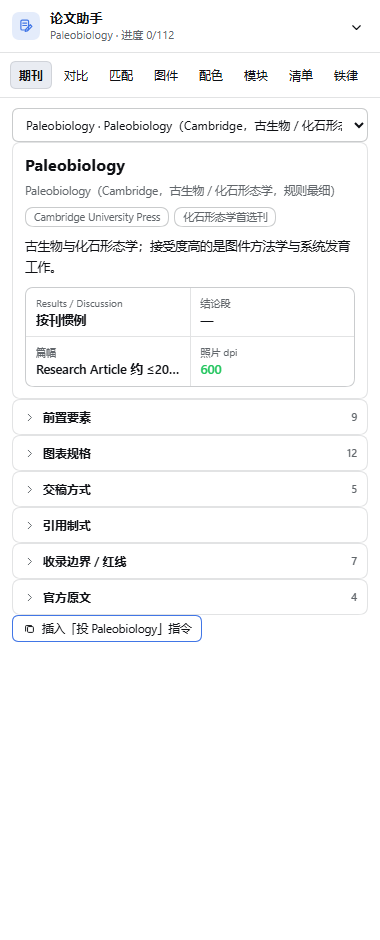

# dsh-academic-paper-polish




把 [academic-paper-polish](https://github.com/syxscott/academic-paper-polish) 打包成 **DeepSeek Harness 插件**：
安装后，Harness 的任意会话都能通过 `skill` 工具加载 `academic-paper-polish`，
并在右栏获得一个 8 视图的「论文助手」面板（期刊档案 / 对比矩阵 / 选刊匹配 / 图件体检 / 配色体检 / 模块 / 自查清单 / 铁律）。

- 内容来源：`syxscott/academic-paper-polish` v2.16.1（MIT），见 `NOTICE`
- 形态：**host + client 双半边** bundle，无第三方依赖、无构建步骤、**无任何外部网络请求**
- 生效范围：`desktop` profile 下所有会话

---

## 能力

| 能力 | 说明 |
|---|---|
| 论文全流程写作 | 10 个模块的规则、硬约束与输出规范（中文 + 英文两套，英文版自包含） |
| 期刊硬约束 | GCA / ES&T / PPP / Paleobiology / APP / PE / JM / Micropaleontology / PalZ / ESR 的结构、篇幅、图件参数，均带官方英文原句 |
| 地学 SCI 专项 | 引文密度表、讨论六步框架、综述 18 步、图件设计体系（5 种原型 + 语义色字典）、微体古生物与系统描述类论文规范 |
| 渐进披露 | 主文件只放框架；`prompts/`、`prompts-en/`、`references/`（15 份）按需读取，不一次性灌进上下文 |

## 工作方式

插件注册一个 **skill provider**（与官方 `dsh-skill-filesystem` 同一套 provider API），
因此：

- 技能目录里所有相对路径都被解析为**安装后的绝对路径**（`{{SKILL_DIR}}` 占位符在注册时替换），
  模型用文件工具按绝对路径读取 `references/`、`prompts/`；
- 技能正文**每次加载都重新读盘** —— 改完 `skill/**` 不需要重启，下次 `skill()` 调用即生效；
- 描述走官方目录渲染（上限 500 字符，实际 126 字符）。

## 安装

由 `plugin_manager` 执行，不要手工改 profile：

```yaml
# 插件调用
plugin_manager:
  action: install_bundle
  target: C:\Users\Administrator\dsh-academic-paper-polish   # ← 见下方「跨盘符约束」
```

安装后可用 `plugin_manager(action: set_plugin, target: 'include:skill-academic-paper-polish', enabled: false)` 停用。

### 🔴 跨盘符约束（本机踩过的坑）

本机 profile 在 `C:` 盘，而源码在 `D:` 盘。**直接用 D: 路径安装会失败**：

```
dsh: cannot resolve profile bundle "dsh-academic-paper-polish" from the dsh installation or
C:\Users\Administrator\.dsh\profiles\desktop
```

原因：pnpm 为 `file:` 依赖生成的符号链接目标按**工作区所在盘**计算相对路径，跨盘时落成
`C:\Users\文档\...` 这种不存在的路径，profile 解析 bundle 时 `existsSync` 失败。

绕法：先在**与 profile 同盘**的位置建一个 junction 指向源码，再从该路径安装。

```powershell
New-Item -ItemType Junction -Path "C:\Users\Administrator\dsh-academic-paper-polish" `
  -Target "D:\文档\编程项目\agent闲聊\dsh-academic-paper-polish"
# 然后 install_bundle 的 target 用 C:\Users\Administrator\dsh-academic-paper-polish
```

源码仍只有一份（junction 指回工作区），改完刷新即生效。

### 备用通道（文件式技能）

若不想用插件通道，把 `skill/academic-paper-polish/` 整个目录拷到 `~/.agents/skills/` 即可，
DSH 的 `dsh-skill-filesystem` 会自动发现（rank 500）。注意：文件式安装时 `SKILL.md` 里的
`{{SKILL_DIR}}` 不会自动替换，需自己填成绝对路径。

> ⚠️ 两条通道**同名会互相遮蔽**：预设层的 `skill-filesystem`（更近的 scope）会盖住宿主层的插件技能。
> 只留一条即可，推荐只留插件通道。


## 前端面板（Web UI）

插件含 **client 半边**，只在**会话右栏**出现一处入口：

| 入口 | 位置 | 说明 |
|---|---|---|
| **右栏页面**（唯一入口） | 会话右栏的 tab，指南页里的「📄 论文助手」胶囊 | 完整面板，8 个视图 |

> 输入框下方的 `conversation.composer.dock` **不再注册**（v2.4.0 起），
> 面板不会在输入框下面占一条窄条；渲染测试里有一条断言专门守着这条规则。

面板有 8 个视图：

| 标签页 | 内容 | 交互 |
|---|---|---|
| **期刊** | 10 本刊的完整档案：收录范围 · Results/Discussion 结构 · 结论段 · 篇幅体裁 · 前置要素 · 图表规格表 · 交稿方式 · 引用制式 · 收录边界红线 · **官方英文原句** | 顶部下拉切换期刊；「插入「投 X」指令」按钮 |
| **模块** | 10 个 prompt 模块（摘要/引言/综述/方法/结果/讨论/结论/去AI化/选刊投稿/审稿回复） | 点一下，调用指令**直接插入输入框** |
| **自查** | 投稿前自查清单 A–K 共 11 组、112 项 | 逐项勾选，进度条 + localStorage 持久化 + 一键重置 |
| **配色** | 图件语义色字典 5 色（人工红 / AI 紫 / 单系列橙 / 环境绿 / 拟合蓝） | 点击复制 HEX |
| **铁律** | 八条跨模块硬规则（倒金字塔、引文密度、六步讨论、地质年代…） | 只读速查 |

> 期刊数据来自两处：skill 自带的 4 份期刊档案（`references/journal-constraints.md`、
> `multi-journal-style-guides.md`、`paleobiology-journal.md`、`micropaleo-paper-patterns.md`，
> 内含逐字英文原文）与 **APP 官网 Instructions for Authors 全文**（2024-01-03 复核）。
> 每本刊都标了「依据文件」，官方原句一律逐字引用、不用中文转述代替。

按钮的投递链：优先 `props.inputActions.insertText(text, captureInsertion())` 把文本插进输入框
（编辑器拒收时自动回退剪贴板），所以点完直接回车就能发。

### 宿主路由：零 token 的全文检索

面板的搜索走宿主注册的**同源 HTTP 路由**，不经过模型、不消耗任何 token：

```
GET /dsh-academic-paper-polish/skill-index              → 38 个文件的元数据索引（30 KB）
GET /dsh-academic-paper-polish/skill-index?q=ZooBank    → 命中文件 + 命中行片段
```

- `?q=` 会**逐行扫描磁盘上的正文**，所以只出现在正文里的术语（如 `ZooBank`、某条期刊硬参数）也能命中；
  返回体只含命中条目 + 140 字片段（KB 级），不把 590 KB 语料推给浏览器。
- 路由不可达时（无 webServer 的 headless profile）面板自动降级到**打包时的内置索引**，
  面板上会显示 🟡 提示，此时只做标题级匹配。
- 改完 `skill/**` 立刻生效：每次请求都重读磁盘。
- 路由套了官方信任栅栏（`connection.requestRejection`：Host/Origin 检查 + 浏览器会话 cookie），
  和 `dsh-host-open-in-app` 等官方路由一致：**没有凭据的外部请求会拿到 401**，
  面板自己的同源 fetch 会自动带上 `dsh-auth-*` 签名 cookie，因此不受影响。
  万一被拒，面板会显示 🟠 提示（"宿主路由拒绝了本次请求"）而不是静默降级。

> 🔴 **前缀路径不能带结尾斜杠**。webserver 的匹配规则是
> `pathname === prefix || pathname.startsWith(prefix + '/')`，
> 注册 `/dsh-academic-paper-polish/` 会去比较 `startsWith('.../dsh-academic-paper-polish//')`，
> **永远匹配不上**，表现为路由静默 404。正确写法见 `index.js`：

```js
scope.webServer.register({
  kind: 'prefix',
  path: '/dsh-academic-paper-polish',   // ← 无结尾斜杠
  handler: (req, res) => { /* … */ },
});
```

### 右栏接入（两段式注册）

右栏的 tab 类型由 `ctx.sidebarRightTabs` 注册，页面 body 注册到 `sidebar.right.pane.tab` 槽位，
**key = 类型定义的 id**（不是 kind）：

```js
// ⚠️ ctx.inject 的回调参数是「子作用域」，服务只在 scope 上；用外层 ctx 会 undefined 抛错
ctx.inject(['sidebarRightTabs'], (scope) => {
  scope.effect(() => scope.sidebarRightTabs.register({
    id: 'dsh-academic-paper-polish',      // 实现身份，全局唯一
    kind: 'academic-paper-polish',         // tab 类型
    title: () => t('type.label'),
    guide: [{ id: 'assistant', order: 40, title: () => t('guide.title'),
              description: () => t('guide.description'), icon: GuideIcon }],
  }), '…: right sidebar tab type');

  scope.slots.inject('sidebar.right.pane.tab', () => scope.slots.register({
    name: 'sidebar.right.pane.tab', key: 'dsh-academic-paper-polish', locale: NS,
  }, Body));
});
```

要点：
- `guide` 数组里的每项 = 指南页的一个胶囊；点胶囊按 `kind` 开右栏页面。
- 指南页是右栏默认页（**有 2 个以上 guide 条目时**才显示指南；只有 1 个时直接开它自己的页面）。
- 客户端模块 id = 包名 `dsh-academic-paper-polish`；样式只用 `--dsw-alias-*` 主题 token，跟随宿主明暗主题。
- **改了 `client.js` 需要重载客户端**（Electron 应用里 Ctrl+R，或重启应用）；宿主半边下次 `skill()` 调用即生效。
- 槽位占用可用 `cordis_inspect_query` 验证：
  `Slots.listSubTree` with `root: "sidebar.right.pane.tab"` → occupants 里应出现 `dsh-academic-paper-polish`；
  同一个 root 换成 `"conversation.composer.dock"` → **不应**出现本插件。

### 八个视图（v2.0）

| 视图 | 内容 | 交互 |
|---|---|---|
| **期刊** | 10 本刊的完整档案：收录范围 · 结构 · 结论段 · 篇幅体裁 · 前置要素 · 图表规格表 · 交稿方式 · 引用制式 · 红线 · 官方英文原句 | 顶部下拉切刊；「插入「投 X」指令」 |
| **对比矩阵** | 10 刊 × 10 维度的横向表格 | 点单元格看完整条款；点刊名跳档案页 |
| **选刊匹配** | 按体裁 / 新分类单元 / 双摘要需求给出排序与理由 | 勾选条件即时重排，评分条动画 |
| **图件体检** | 输入 dpi / 宽 / 高 / 体积 → 按当前刊规则逐条判定 | ✅ / ❌ / ⚠️ 三态 + 差额提示 |
| **配色体检** | 输入 HEX → WCAG 对比度、灰度值、deutan / protan / tritan 模拟 | 两两灰度可分辨性判定 |
| **模块** | 10 个 prompt 模块 + 全量文件**正文**检索（走宿主路由） | 点模块插入输入框；搜索命中文件显示命中行片段，可一键让 Agent 读取 |
| **自查** | 投稿前自查清单 A–K 共 11 组、112 项 | 勾选 + 分组进度条 + 全部展开/重置 |
| **铁律** | 八条跨模块硬规则 | 只读速查 |

**交互细节**：数字键 `1–8` 切视图、`/` 聚焦搜索框；当前视图 / 选刊 / 匹配条件 / 配色 / 图件参数 / 勾选状态全部写入 localStorage；标签页切换有 180ms 淡入位移、进度条与评分条有缓动动画，并尊重 `prefers-reduced-motion`。

### 视觉自验证管线（本机可复用）

面板的所有视觉修复都经过**真实截图验证**，不再盲写样式：

```bash
node scripts/extract-theme-tokens.mjs  # 从 app.asar 抽真实主题 CSS → preview/tokens.css
node scripts/shoot-views.mjs           # Chrome headless 批量截图 8 个视图 → preview/view-*.png
node scripts/shoot-views.mjs dark      # 暗色（用的是真机同一套 token）
node scripts/render-test.mjs           # headless 渲染 8 视图 × 2 槽位，捕获渲染崩溃
node scripts/dump-view.mjs match       # 导出某视图渲染后的 HTML
```

`preview/panel.html` 是独立预览台：真实 React UMD + 真实 token + `?view=` 切视图 + `?dark=1` 切主题 +
`?diag=1` 把 computed style 写进 `document.title` 供 `--dump-dom` 读取。

> ⚠️ 主题 CSS 必须**整段**从 app.asar 抽（`scripts/extract-theme-tokens.mjs` 取
> `dsh-client-ui-theme/lib/client.js` 里的 `*_css_default` 字符串）。
> 只抽第一段 `body{…}` 会丢掉 `body[data-ds-dark-theme]` 那份 alias 覆盖，
> 结果是**暗色截图和亮色逐字节相同**——看起来"验过了"，其实暗色根本没渲染过。

### 全量自检

```bash
node scripts/audit.mjs               # 静态审计：语法 / 外链 / fetch 面 / CSS 变量 / 版本
node scripts/smoke-test.mjs          # 技能 provider 离线自检
node scripts/host-route-test.mjs     # 宿主路由：索引 + 全文检索 + 405/404 + 前缀匹配
node scripts/render-test.mjs         # 8 视图 × 2 槽位渲染无崩溃
node scripts/run-interaction-test.mjs # 浏览器内 40 条交互断言（点击/输入/持久化）
node scripts/check-inline-scripts.mjs # 预览台内联脚本语法
node scripts/code-metrics.mjs        # 代码量统计
```

### 视觉设计（v1.1.0）

面板不是零散内联样式堆出来的，而是一套 **token 驱动的设计系统**：

- 组件内注入一段 `<style>`（React 渲染，卸载自动移除），所有类名走 `.dapp-*` 前缀，不污染宿主；
- 颜色**只用** `--dsw-alias-*` 主题 token，派生色用 `color-mix(in srgb, var(--dsw-alias-…) N%, transparent)` → 明暗主题自动跟随；
- 图标全是自绘线性 SVG（1.5px、`currentColor`），不用 emoji、不用宿主组件；
- 每个可点元素都有 hover / active(0.985) / focus-visible(品牌色描边) 三态 + 130ms 过渡；
- 字号阶梯 10 / 10.5 / 11 / 11.5 / 12.5 / 13px，间距 4 / 6 / 8 / 10 / 12 / 14px，数字 `tabular-nums`。

五个标签页各自的形态：期刊=徽章行 + 键值表 + chip 阵列 + 左侧警示竖线；模块=图标卡片网格；
自查=进度条 + 手风琴分组 + 自绘复选框；配色=色块卡片；铁律=编号卡片。

## 目录结构

```
dsh-academic-paper-polish/
├── index.js                  # 宿主半边：skill provider + 零 token 全文检索路由（357 行）
├── client.js                 # 客户端半边：论文助手面板（React，3792 行）
├── cordis.patch.yml          # bundle patch：向 profile 插入插件行
├── package.json              # bundle manifest（dsh.bundle.patch + dsh.client）
├── locale/{en,zh}.json       # 插件管理器展示文案
├── icon.svg                  # 原创图标
├── scripts/                  # 自检与视觉管线（16 个脚本，1533 行）
├── preview/                  # 独立预览台 + 16 张视图截图
└── skill/
    └── academic-paper-polish/ # ← 可整目录拷走当 Claude Code skill 用
        ├── SKILL.md          # 主文件（已加 DSH 适配段）
        ├── prompts/          # 10 个中文模块
        ├── prompts-en/       # 10 个英文模块（自包含）
        ├── references/       # 15 份深度参考
        ├── docs/             # COMPATIBILITY / PROMPTS-EN
        └── agents/openai.yaml
```

## 代码量

| 层 | 文件 | 代码行 | 体积 |
|---|---|---|---|
| 宿主 `index.js` | 1 | 294 | 13.5 KB |
| 客户端 `client.js` | 1 | 3566（JS 2345 + CSS 184 + 内置索引数据 1037） | 160.9 KB |
| 脚本 `scripts/` | 12 | 1438 | 68.6 KB |
| 预览台 `preview/` | 3 + 16 张图 | 368 | 56.2 KB |
| **技能内容** `skill/` | 39 | 7093 行 / **59 490 词** | 590.6 KB |
| **合计** | 81 | **14 188 行** | 1.68 MB |

运行时代码 ≈ **2 639 行**（宿主 294 + 客户端 JS 2345），技能内容 59 490 词——
插件代码只占交付体积的 **24%**，其余是模型按需读取的知识。

## 自检

```bash
node --check index.js
node scripts/smoke-test.mjs
```

## 从上游同步

```powershell
$src = "D:\文档\编程项目\agent闲聊\academic-paper-polish-src"
$dst = "D:\文档\编程项目\agent闲聊\dsh-academic-paper-polish\skill\academic-paper-polish"
git -C $src pull
# 只覆盖 prompts/ prompts-en/ references/ docs/ agents/，SKILL.md 保留 DSH 适配段
Copy-Item "$src\skills\academic-paper-polish\prompts\*"   "$dst\prompts\"   -Recurse -Force
Copy-Item "$src\skills\academic-paper-polish\prompts-en\*" "$dst\prompts-en\" -Recurse -Force
Copy-Item "$src\skills\academic-paper-polish\references\*" "$dst\references\" -Recurse -Force
Copy-Item "$src\docs\*"                                   "$dst\docs\"       -Force
```

## 许可

插件代码 MIT；`skill/**` 内容继承上游 MIT（`LICENSE.upstream`）。
